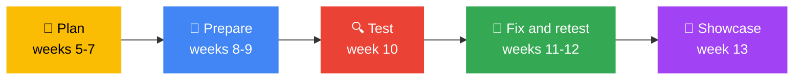

# 🛡️ Finance Web Security | GDG on Campus TUM

### Plan it. Build it. Break it. Fix it.

[](#) [](#) [](#) [](#)

[🚀 Getting Started](GETTING-STARTED.md) · [⚖️ Rules](ETHICS-AND-RULES.md) · [🗓️ Roadmap](roadmap/week-by-week.md) · [📘 The Plan](plan/01-project-goal.md) · [🧪 Test Cases](test-cases/README.md) · [🧾 Templates](templates/vulnerability-register.md) · [✅ Checklists](checklists/requirements-checklist.md) · [🔍 Findings](findings/README.md) · [📄 Reports](reports/README.md) · [👥 Members](members/README.md) · [📌 Open Items](OPEN-ITEMS.md) · [❓ FAQ](FAQ.md)

* * *

> **Cybersecurity Track Lead:** Kimberly ([kimmy-sec](https://github.com/kimmy-sec)) · **Web Track Lead:** *[TO CONFIRM]* · **Chairperson:** *[TO CONFIRM]* · **Weekly check-in:** *[TO CONFIRM] day, time, venue* · **Channel:** *add group link*

This is the joint **Web × Cybersecurity project** of GDG on Campus TUM. The Web track builds a **student finance web-application prototype**, inspired by the functions of a university finance portal. The Cybersecurity track makes sure security is part of the work **from planning through testing**: defining requirements, assessing risks, coordinating authorised testing, and documenting fixes and limitations.

It is the **Build stage** project of the [Cybersecurity Track](https://github.com/GDG-TUM/CYBERSECURITY-TRACK-GDG-on-Campus-TUM/blob/main/projects/cyber-x-web/README.md) pathway.

> [!NOTE]
> **Status: draft for coordination with the Web track lead and chairperson.** Items marked **[TO CONFIRM]** are waiting for decisions. See [OPEN-ITEMS.md](OPEN-ITEMS.md).

> [!IMPORTANT]
> **Read the [rules of engagement](ETHICS-AND-RULES.md) before anything else.** We build and test **our own prototype** with **fictional student records and simulated transactions**. **Never test the live TUM finance system** without explicit written authorisation. Unauthorised access is illegal, including under Kenya's Computer Misuse and Cybercrimes Act.

> [!TIP]
> **Lost in this repo?** Click the **☰ outline button** at the top right of this page for a clickable table of contents. Every other page has a **← Back to Finance Web Security home** link at the top.

### Jump around this page

[🧭 Start here](#start) · [🤝 Who does what](#who) · [🔐 What we protect](#protect) · [🎯 Goals](#goals) · [🗓️ Calendar](#calendar) · [🧪 What we test](#test) · [✅ Get involved](#involved) · [⚠️ Good to know](#good-to-know) · [🔗 Related links](#related) · [🗂️ Repo map](#repo-map) · [📬 Contact](#contact)

* * *

<a id="start"></a>

## 🧭 Start here: how to use this repo

### New? Follow these 5 steps

| Step  | Do this                                                         | Where                                              |
|:-----:|-----------------------------------------------------------------|----------------------------------------------------|
| **1** | Read the rules of engagement (5 minutes)                        | [ETHICS-AND-RULES.md](ETHICS-AND-RULES.md)         |
| **2** | Complete the setup checklist                                    | [GETTING-STARTED.md](GETTING-STARTED.md)           |
| **3** | Read what we protect and why                                    | [The plan](plan/01-project-goal.md)                |
| **4** | Make your first contribution by adding your profile             | [members/](members/README.md)                      |
| **5** | Share your plan with the chapter                                | [member-roadmaps](https://github.com/GDG-TUM/member-roadmaps) |

### Or jump straight to what you need

| I want to...                                  | Go here                                                                 |
|-----------------------------------------------|-------------------------------------------------------------------------|
| **Know what is allowed and what is not**      | [Rules of engagement](ETHICS-AND-RULES.md)                              |
| **Understand what we are protecting**         | [What we protect](plan/02-assets-to-protect.md)                         |
| **See the week-by-week plan**                 | [Roadmap](roadmap/week-by-week.md)                                      |
| **Check the security requirements**           | [Requirements checklist](checklists/requirements-checklist.md)          |
| **Write or run test cases**                   | [Test cases](test-cases/README.md)                                      |
| **Report a vulnerability we found**           | [Finding report template](templates/finding-report.md)                  |
| **Track all findings**                        | [Vulnerability register](templates/vulnerability-register.md)           |
| **Prepare to test safely**                    | [Before testing](checklists/pre-testing.md)                             |
| **Prepare the Week 13 showcase**              | [Before the showcase](checklists/pre-showcase.md)                       |
| **Learn the web security basics**             | [Learning priorities](plan/04-learning-priorities.md) and [resources](plan/05-starter-resources.md) |
| **Work with the Web track**                   | [Coordination](plan/06-coordination.md)                                 |
| **Ask a question**                            | [Open a question issue](https://github.com/GDG-TUM/Finance-Web-Security-GDG-on-Campus-TUM/issues/new/choose) |
| **Get answers to common questions**           | [FAQ](FAQ.md)                                                           |

### Your journey through the project



* * *

<a id="who"></a>

## 🤝 Who does what

| Track                   | Owns                                                                                                              |
|-------------------------|-------------------------------------------------------------------------------------------------------------------|
| **Web track**           | Application structure and features                                                                                |
| **Cybersecurity track** | Security requirements, risk assessment, coordination of authorised testing, documentation of fixes and limitations |

<a id="protect"></a>

## 🔐 What we protect

| Asset                            | The rule                                                                                                  |
|----------------------------------|-----------------------------------------------------------------------------------------------------------|
| **Student financial information** | Fee balances, statements, payment histories and student details are visible only to the correct account or authorised staff |
| **Payment integrity**             | A transaction is marked successful only after the **server** verifies the result. The browser is never trusted to set balances or status |
| **Finance staff actions**         | Only authorised staff make adjustments, and important changes leave an audit trail (who, what, when)      |
| **Account and session security**  | Logins, sessions, password-reset flows and privileged accounts are protected where in scope               |

[Full detail →](plan/02-assets-to-protect.md)

* * *

<a id="goals"></a>

## 🎯 Project goals

By the Week 13 showcase, the team should be able to show:

1. A security plan and requirements agreed with the Web lead before or early in development
2. Test cases tied to the **actual** finance-portal features
3. Authorised findings that are recorded, prioritised, fixed where feasible and retested
4. A repository with clear security notes and **no committed credentials or tokens**
5. A demo that explains the risk, the control or fix, and the retest result, plus honest limitations

[Definition of success →](plan/07-definition-of-success.md)

* * *

<a id="calendar"></a>

## 🗓️ Week-by-week calendar

Click through for details. [Full roadmap →](roadmap/week-by-week.md)

| Weeks | Stage | Cybersecurity actions | Deliverable |
|-------|-------|-----------------------|-------------|
| 5–6   | Plan | Meet the Web lead; confirm features, roles, data, technology and deployment plan; identify key risks | [Security brief](templates/security-brief.md) and [threat list](templates/threat-list.md) |
| 7     | Plan | Agree testing boundaries; create checklist, test-plan template and vulnerability register | Security workflow and [templates](templates/vulnerability-register.md) |
| 8–9   | Prepare | Study relevant OWASP risks; review new features; prepare test cases | Prioritised [test cases](test-cases/README.md) and review notes |
| 10    | Test | Test our own development version with permission: access control, input handling, sessions and transaction logic as applicable | Initial [findings](findings/README.md) and remediation tasks |
| 11–12 | Fix and retest | Work with developers to fix findings; retest; complete security notes and report | [Retest log](templates/retest-log.md) and draft report |
| 13    | Showcase | Demonstrate the prototype, safely show a finding and its fix, explain remaining limitations | Security demo and final report |

**[TO CONFIRM]** calendar dates for each week, aligned with the academic calendar.

* * *

<a id="test"></a>

## 🧪 What we test

Six areas, each with starter test cases to tie to real features:

| Area | Starter cases | OWASP link |
|------|---------------|------------|
| [Access control](test-cases/access-control.md) | A student can only reach their own records; finance functions are role-restricted | Broken access control |
| [Authentication and sessions](test-cases/authentication-sessions.md) | Password storage, cookies, logout, reset flow | Authentication failures |
| [Input and output handling](test-cases/input-output.md) | Server-side validation, parameterised queries, output encoding | Injection |
| [Financial business logic](test-cases/business-logic.md) | Server-side balances, payment verification, duplicate requests | Insecure design |
| [Secrets, dependencies, config](test-cases/secrets-dependencies-config.md) | No secrets in Git, dependency review, non-debug settings, HTTPS | Security misconfiguration |
| [Audit logs](test-cases/audit-logs.md) | Who, what and when for financial changes, without logging secrets | Logging failures |

* * *

<a id="involved"></a>

## ✅ How to get involved

1. Join the [**GDG-TUM** GitHub organization](https://github.com/GDG-TUM) and turn on two-factor authentication
2. Add your plan in [**member-roadmaps**](https://github.com/GDG-TUM/member-roadmaps) (open a *Member Roadmap* issue)
3. Make your first contribution by [adding your profile](members/README.md)
4. Pick up a task from the [issues](https://github.com/GDG-TUM/Finance-Web-Security-GDG-on-Campus-TUM/issues) or the [org Projects board](https://github.com/orgs/GDG-TUM/projects)
5. Join the weekly check-in with the Web track. **[TO CONFIRM]** day, time and venue
6. Read the [CONTRIBUTING guide](https://github.com/GDG-TUM/.github/blob/main/CONTRIBUTING.md) before your first pull request

* * *

<a id="good-to-know"></a>

## ⚠️ Good to know

> [!WARNING]
> **Never test anything you do not own or have written permission to test**, including the live TUM finance system, campus, employer and friends' systems, "just to see". Test only our own prototype or an explicitly authorised training lab.

- **Fictional data only.** Use fictional student records and simulated payments. No real student data, ever.
- **Never commit secrets.** No passwords, API keys, tokens, real payment credentials or `.env` files in any repo. If it happens, tell a maintainer immediately. See the [security policy](https://github.com/GDG-TUM/.github/blob/main/SECURITY.md).
- **No disruptive tests** against any live service.
- **Report findings properly:** reproduction steps, affected feature, impact, evidence, severity, recommended fix, owner and retest status.
- **Be kind.** We follow the [Code of Conduct](https://github.com/GDG-TUM/.github/blob/main/CODE_OF_CONDUCT.md). Findings are about the code, never about the person who wrote it.
- **Disclose honestly.** Unresolved issues are listed at the showcase, not hidden.

* * *

<a id="related"></a>

## 🔗 Related links

### Inside this repo

| Page | What it is |
|------|------------|
| [⚖️ Ethics and rules](ETHICS-AND-RULES.md) | Rules of engagement and the authorisation record |
| [🚀 Getting started](GETTING-STARTED.md) | Accounts, tools and prototype access |
| [📌 Open items](OPEN-ITEMS.md) | Decisions still to confirm |
| [🗓️ Week-by-week roadmap](roadmap/week-by-week.md) | Weeks 5 to 13 with deliverables |
| [📘 The plan](plan/01-project-goal.md) | Seven sections: goal, assets, requirements, learning, resources, coordination, success |
| [🧾 Templates](templates/vulnerability-register.md) | [Register](templates/vulnerability-register.md) · [Finding report](templates/finding-report.md) · [Test plan](templates/test-plan.md) · [Threat list](templates/threat-list.md) · [Security brief](templates/security-brief.md) · [Retest log](templates/retest-log.md) |
| [✅ Checklists](checklists/requirements-checklist.md) | [Requirements](checklists/requirements-checklist.md) · [Before testing](checklists/pre-testing.md) · [Before the showcase](checklists/pre-showcase.md) |
| [🧪 Test cases](test-cases/README.md) | [Access control](test-cases/access-control.md) · [Auth and sessions](test-cases/authentication-sessions.md) · [Input and output](test-cases/input-output.md) · [Business logic](test-cases/business-logic.md) · [Secrets and config](test-cases/secrets-dependencies-config.md) · [Audit logs](test-cases/audit-logs.md) |
| [🔍 Findings](findings/README.md) · [📄 Reports](reports/README.md) · [👥 Members](members/README.md) | Work in progress |

### Across GDG on Campus TUM

| Link | What it is |
|------|------------|
| [🏠 GDG-TUM organization](https://github.com/GDG-TUM) | All chapter repositories |
| [🔐 Cybersecurity Track](https://github.com/GDG-TUM/CYBERSECURITY-TRACK-GDG-on-Campus-TUM) · [site](https://gdg-tum.github.io/CYBERSECURITY-TRACK-GDG-on-Campus-TUM/) | The track this project belongs to |
| [🤝 Cyber × Web project page](https://github.com/GDG-TUM/CYBERSECURITY-TRACK-GDG-on-Campus-TUM/blob/main/projects/cyber-x-web/README.md) | Project overview on the Cybersecurity track side |
| [☁️ Cloud Track](https://github.com/GDG-TUM/Cloud-Track-GDG-on-Campus-TUM) · [site](https://gdg-tum.github.io/Cloud-Track-GDG-on-Campus-TUM/#/) | Cloud security checklist and deployment help |
| [🗺️ member-roadmaps](https://github.com/GDG-TUM/member-roadmaps) | Share your personal plan with the chapter |
| [📋 Chapter project board](https://github.com/orgs/GDG-TUM/projects) | Chapter-wide tasks and plans |
| [🌐 This project's site](https://gdg-tum.github.io/Finance-Web-Security-GDG-on-Campus-TUM/) | The Docsify version of this repo |
| [💬 Ask a question](https://github.com/GDG-TUM/Finance-Web-Security-GDG-on-Campus-TUM/issues/new/choose) | Open an issue |
| [📜 Contributing](https://github.com/GDG-TUM/.github/blob/main/CONTRIBUTING.md) · [Security policy](https://github.com/GDG-TUM/.github/blob/main/SECURITY.md) · [Code of Conduct](https://github.com/GDG-TUM/.github/blob/main/CODE_OF_CONDUCT.md) | Chapter-wide policies |

### External learning links

[MDN HTTP guide](https://developer.mozilla.org/en-US/docs/Web/HTTP/Guides/Overview) · [OWASP Top 10](https://owasp.org/projects/top-ten?lang=en) · [PortSwigger Web Security Academy](https://portswigger.net/web-security) · [OWASP ZAP](https://www.zaproxy.org/) · [Burp Suite Community](https://portswigger.net/burp/communitydownload) · [GitHub Docs](https://docs.github.com/)

* * *

<a id="repo-map"></a>

## 🗂️ Repo map

```
Finance-Web-Security-GDG-on-Campus-TUM/
├── README.md                  ← you are here
├── ETHICS-AND-RULES.md        ← rules of engagement (read first)
├── GETTING-STARTED.md         ← setup checklist
├── FAQ.md
├── OPEN-ITEMS.md              ← decisions still to confirm
├── plan/                      ← the security plan, section by section
├── roadmap/                   ← week-by-week plan, weeks 5 to 13
├── templates/                 ← register, finding report, test plan, threat list, brief, retest log
├── checklists/                ← requirements, before testing, before showcase
├── test-cases/                ← starter test cases for six areas
├── findings/                  ← one file per finding (V-01, V-02 ...)
├── reports/                   ← draft and final report
├── members/                   ← add your profile (first pull request)
└── .github/ISSUE_TEMPLATE/    ← finding, review request, question
```

* * *

<a id="contact"></a>

## 📬 Contact

|                                   |                                                                                   |
|-----------------------------------|-----------------------------------------------------------------------------------|
| 🏠 **GitHub organization**         | [github.com/GDG-TUM](https://github.com/GDG-TUM)                                  |
| 📋 **Chapter project board**       | [GDG-TUM Projects](https://github.com/orgs/GDG-TUM/projects)                      |
| 🔐 **Cybersecurity Track**         | [CYBERSECURITY-TRACK-GDG-on-Campus-TUM](https://github.com/GDG-TUM/CYBERSECURITY-TRACK-GDG-on-Campus-TUM) |
| 💼 **LinkedIn**                    | [GDG on Campus TUM](https://www.linkedin.com/company/gdg-on-campus-tum/)          |
| ✉️ **Email**                      | gdgtum@gmail.com                                                                  |
| 💬 **Questions about this project** | [Open an issue](https://github.com/GDG-TUM/Finance-Web-Security-GDG-on-Campus-TUM/issues/new/choose)                  |

📄 Licensed under the [MIT License](LICENSE).

[⬆️ Back to top](#)

**Plan → Prepare → Test → Fix → Showcase** 🛡️
